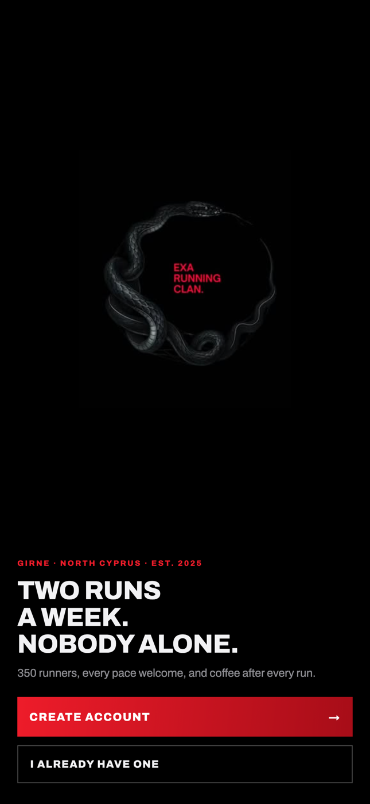
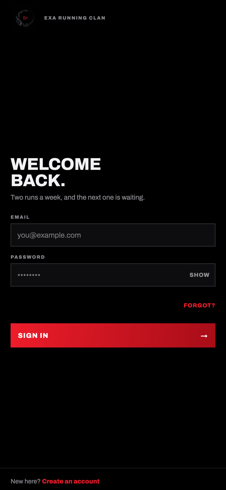
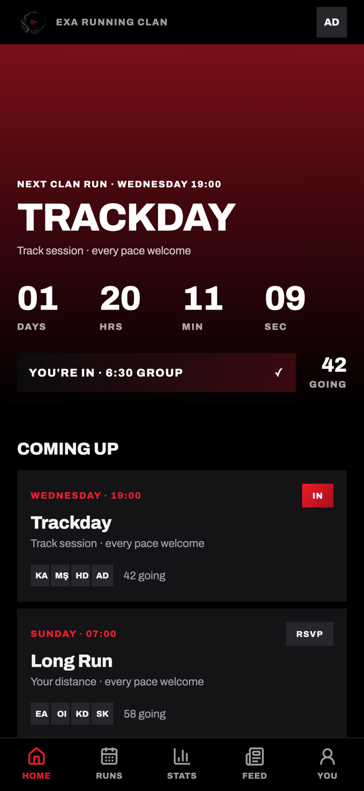

# Exa Running Clan

Mobile app for Exa Running Clan — a running group of about 350 in Girne, North
Cyprus, founded in 2025, with two weekly runs: Wednesday Trackday and Sunday long
run. Built from the design handoff in
[`design_handoff_exa_running_clan/`](design_handoff_exa_running_clan/).

**Expo (React Native) + TypeScript + Supabase.** One codebase for iOS, Android and web.

<p>
  
  
  
</p>

Welcome, sign in and Home, with the demo data from `supabase/seed.sql`.

---

## Setup

```sh
npm install
cp .env.example .env          # fill in your Supabase URL + anon key
npx expo start
```

Press `i` for iOS, `a` for Android, `w` for web.

Without a `.env`, the app runs and shows the auth screens with a setup notice —
the five tab screens need a database behind them.

### Database

The schema, RLS policies, aggregate RPCs and a development seed live in
[`supabase/`](supabase/).

With the [Supabase CLI](https://supabase.com/docs/guides/local-development):

```sh
supabase link --project-ref <your-project-ref>
supabase db push              # migrations
psql "$DATABASE_URL" -f supabase/seed.sql
```

Or paste the files into the SQL editor in order:
`0001_schema.sql` to `0005_girne.sql` in order, then `seed.sql`.

The seed creates the two run series, an invented 120-strong roster, twelve weeks
of activity history, RSVPs, feed posts, run chat and a clan challenge. Their start
times and meeting points are placeholders until the club's real ones are added.
Every demo account signs in with the password **`exaclan2026`**; sign in as
`ayse@exaclan.test`.

### Going live

The app is in Turkish and English; the strings are in `src/i18n/`. Run names and
details are stored once, in whichever language a leader types them.

1. Apply `supabase/migrations/0005_girne.sql` and `0006_features.sql`. Don't run
   `seed.sql` against a real project: it's demo data.
2. Create the two weekly runs, then make the first admin in the SQL editor:
   `update public.member set role = 'admin' where email = '...';`
   After that, leaders can edit runs and add races in the app.
3. In **Authentication → URL Configuration**, allow the `exaclan://**` redirect so
   the confirmation and password reset links can open the app.
4. For alerts about changed runs and new comments: `eas init`, make a development
   build, and `supabase functions deploy notify`. Reminders 12 hours before a run
   work without this.

Strava is hidden until it has a server-side OAuth callback.

---

## Layout

```
app/                  routes (expo-router)
  (tabs)/             the five-tab shell — home, runs, stats, feed, you
  (auth)/             welcome, sign-in, register, done
  settings.tsx        pushed over the tabs
src/
  theme/              design tokens, typography, light + dark palettes
  ui/                 primitives — buttons, chips, sheet, charts, avatars
  screens/            one file per screen, plus the run-detail sheet
  data/               Supabase client, API calls, formatting
  state/              auth session and the app-wide clan store
supabase/
  migrations/         schema, RLS, aggregate RPCs
  seed.sql            development data
```

### How the data flows

Every screen reads from one store (`src/state/ClanProvider.tsx`). The handoff
asks for a single source of truth per run id — toggling an RSVP has to move the
Home button, the list chip and the sheet footer together, along with the going
count — so no screen keeps its own copy.

Aggregates are computed in Postgres, not on the device. Each screen maps to one
call:

| Screen | Call |
| --- | --- |
| Home, Schedule | `api_upcoming_runs` |
| Run sheet | `api_run_detail` |
| Stats | `api_my_stats` + `api_leaderboard` |
| Feed | `api_feed` |
| Races | `api_races` |
| Challenge bar | `api_active_challenge` |
| Profile | `api_me` |

That also means "this week" is defined once, and it is the club's week:
everything is stored UTC and bucketed in `Asia/Nicosia`, the same clock Girne
keeps, so a member travelling abroad still sees the clan's Wednesday.

Writes are optimistic — RSVP, kudos and pace group apply locally, then reconcile
against the count the server returns. A failure rolls the change back and
surfaces a toast rather than leaving the UI quietly wrong.

---

## Design

The auth screens follow the handoff exactly. The app after login deliberately
departs from it to read as the same product as auth, because the handoff's light,
ruled layout felt like a different app once it sat behind that black flow:

- **Dark by default**, whatever the device is set to. Light and System remain in
  **Settings → Appearance**; the choice is stored on the device.
- **Fills instead of rules.** Tiles and space separate content. Radius stays 0 and
  there are still no shadows.
- **A larger type scale.** `section`, `rowTitle`, `appBody`, `appMeta` and
  `appLabel` in `src/theme/type.ts` are in-app only; don't apply them to auth.
- **Lucide icons** on the tab bar, square-capped to match the zero radius.
- **A 20pt gutter**, the same as auth.

Settings is not in the handoff. It exists because the light/dark choice, the
notification preferences, the kit size, the emergency contact and the monthly
target behind the Stats ring had nowhere else to live. It is pushed over the tabs
rather than added as a sixth; the tab bar stays at five.

### Photography and maps

Both are real now. Photographs are rendered grayscale as specified, via a
render-time filter (`src/ui/filters.ts`) rather than by converting on upload —
the originals stay in colour, so going colour later is a one-line change.

**Feed photos** are member uploads. The bucket is **private**, because the clan
is a membership and every other read in this schema requires a session; the
client signs read URLs in batches and caches them (`src/data/photos.ts`).
Uploads are downscaled to 1080px on the device and land in `posts/<member_id>/`,
which is exactly what the storage policy checks. `api_create_post` writes the
post and its photo rows in one call and ignores any path outside the caller's
own folder.

**The Home hero** is club photography, not a member upload. Nothing in the
handoff said where it comes from, so it follows the shape the meet point already
uses: `run_series.hero_photo_path` with a per-occurrence
`override_hero_photo_path`, writable by leaders under `runs/`. Null falls back to
a red gradient field.

**The meet-point map** is built from raster tiles (`src/ui/MeetMap.tsx`) rather
than a map SDK. The design shows a fixed 130px band on one point — there is
nothing to pan — and tiles need no API key, run in Expo Go and in the browser
rather than forcing a native dev build, and look identical on every platform.
Tapping hands off to the phone's own maps app for directions. Swap in
react-native-maps behind the same props if pan/zoom is ever wanted.

> **Before launch:** `TILE_URL` in `MeetMap.tsx` points at the public
> OpenStreetMap tile server, which is fine for development but asks that
> production traffic use a proper provider. Point it at your own tile host or a
> commercial one (MapTiler, Stadia, Thunderforest). It is the only line to change.

---

## Notes on the handoff's open questions

`DATA_MODEL_AND_API.md` §6 lists nine gaps. Where a decision was needed to ship a
working screen, one was made and marked in the code:

| Gap | What was done |
| --- | --- |
| 1. Monthly target behind the ring | `member.monthly_target_m`, defaulting to 150 km, set from **Settings → Monthly target**. Closed. |
| 2. Cancelled / moved run | Built — leaders set it in `app/manage-run.tsx`; it shows on the run tile and sheet, and blocks RSVPs. Closed. |
| 3. Log a run | Built — `app/log-run.tsx`, reached from **Log a run +** on Home and the empty Stats chart. Closed. |
| 4. Comments view | Built — `app/post/[id].tsx`, opened from a post's comment count. Closed. |
| 5. Post composer | Built — `app/compose.tsx`, reached from **Post +** on the feed. Laid out as the post it produces: author row, photograph, words, in the feed's own order and measurements, with the photo shown desaturated because that is how the feed renders it. Closed. |
| 6. Membership payment | Not started — out of scope for the designs. |
| 7. First-timer state on the run sheet | Not started. |
| 8. Empty states | Written for feed, stats, races and the schedule. |
| 9. Error / offline | Optimistic writes roll back with a toast. |

Two figures in the prototype are illustrative rather than achievable, and the
seed departs from them so the screens agree with each other:

- Its bar chart shows 34 km for the current week while the panel beside it says
  24.6. Here every number is derived from seeded activity, so they match.

---

## License

[MIT](LICENSE)
